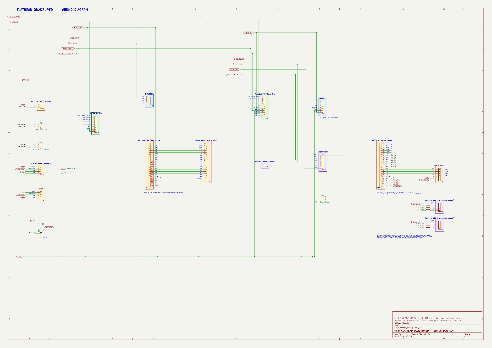

# Flathead Autonomous Quadruped

3D printed Autonomous Quadruped robot using camera vision, all inspired by the Cyberpunk 2077 flathead robot.


## Demo

https://drive.google.com/file/d/12_6V4TeB604TGq49_DJ_Ktc-aOF2DAQ_/view?usp=drive_link

## CAD Model


This shows the model while viewing fusion. The robot for the most part is printed in 2 main separate pieces and is put together using M4 screws. The robot is made up of the front containing the head which will contain the main electronics and the back end containing the battery. To connect the servos together, aluminum servo horns are used for ideal strength and for ease of use.

## Wiring



Attached is a basic preview of what the wiring will look like for the flathead. A more detailed version can be found in [wiring_guide.md](wiring_guide.md) and the full KiCad schematic is in [wiring/](wiring/) ([PDF](wiring/Flathead_Wiring.pdf)). As shown, the project will mostly be running off of two separate step down converters, one end for the servos and the other for the brain, which will handle the raspberry pi, esp32, and all other fundamental parts to keep the robot running.

## Features

(Work in progress)

- Quadruped robot with 3DOF per leg
- Robot uses AI vision through the Pi camera to navigate its environment
- Robot uses AI and Elevenlabs to simulate a rogue AI from Cyberpunk 2077 and can be spoken to
- LEDs light up the front of the robot
- Robotic arms with 3DOF per arm plus a rack and pinion gripper to pick up items

## How to run it locally

Available now — leg inverse kinematics (no hardware required):

Requires g++ (C++11 or later).

```
git clone https://github.com/michaelsumin78-hue/flathead_robot.git
cd flathead_robot/flathead-quadruped_code
g++ -O2 -o test_ik test_ik.cpp
./test_ik
```

Expected output: round-trip error of 0.0000mm on every test case, plus
standing pose a swing phase sweep

## Coming once the hardware is built

- [ ] ESP32 firmware flash (PlatformIO project, board config TBD)
- [ ] Gait engine running on hardware
- [ ] Pi-side vision and voice pipeline setup
- [ ] Full bring-up sequence: power-on order, safety checks, first servo test

## How I made this

The leg geometry went through several revisions driven primarily by torque calculation. To add on, the project was initially intended to use dog-like leg structure but I decided to scrap that and redo the legs after looking at in game footage of the robot in Cyberpunk and seeing videos of people developing spider robots that use a different degree of rotation. When I redid, I changed the leg design visually in many ways, but I also added a slot to have a TPU printed part at the soles of the feet to allow more friction and therefore allow the robot to walk easier.

The overall body was developed by using a 3D model to look around the entire body and see how I should model the robot to remain faithful to the game. I did however have to take some creative liberties of my own as I realized that certain parts of the in game robot were not desirable in my project. I added more interior space to have more room for the electronics, cut out parts of the front to have LEDs visible, adjusted certain parts to be longer or shaped differently to hold motors and what not. I also had to slice the robot in half between the leg and the back torso containing the battery as I realized not only would most commercial printers not be able to print the entire thing in one sitting because of the robot's length, but it would also take far too long as just the front of the bot takes 14 hours optimally to print.

## Credits

Credit to Muhammad Qasim Sajid for creating the [rack and pinion gear](https://grabcad.com/library/rack-and-pinion-gear-precision-linear-motion-cad-assembly-mechanical-power-transmission-design-1) which I built part of the arm design off of.

## Bill of Materials

Also available as [BOM.csv](BOM.csv).

| Item | Qty | Unit Cost | Total Cost | Link | Notes |
| --- | --- | --- | --- | --- | --- |
| MG996R Servos (5 pack) | 3 | $19.08 | $57.24 | [link](https://www.aliexpress.com/item/3256807209626078.html) | Option: MG996R--180-5pcs |
| MG90S Servos (4 pack) | 2 | $12.35 | $24.70 | [link](https://www.aliexpress.us/item/3256812283414632.html) | Option: 4pcs MG90S-180 (old listing does not ship to the US) |
| TPU Filament | 1 | $15.60 | $15.60 | [link](https://www.aliexpress.com/item/3256811821156628.html) | ERYONE TPU 95A 500g |
| 2S 2200mAh 7.4V LiPo | 1 | $22.99 | $22.99 | [link](https://www.amazon.com/dp/B0H8PK3YT3) | OVONIC 2S 2200mAh XT60; previous listing went unavailable |
| XT60 Plug | 1 | $8.99 | $8.99 | [link](https://www.amazon.com/gp/product/B07QH249CR/ref=ox_sc_act_title_26?smid=A1JTH8JAMM4IYJ&psc=1) |  |
| Buck Converter for Servos | 1 | $3.07 | $3.07 | [link](https://www.aliexpress.com/item/3256809620604479.html) | 300W XL4016-class buck |
| Buck Converter for ESP | 1 | $6.59 | $6.59 | [link](https://www.aliexpress.com/item/3256808644352772.html) | HENGE UBEC, option: 4A |
| 4700uF Capacitor | 1 | $2.47 | $2.47 | [link](https://www.aliexpress.us/item/3256804690325267.html) | 2-pack, 50V |
| Wire Stripper | 1 | $8.68 | $8.68 | [link](https://www.aliexpress.com/item/3256811776285441.html) |  |
| Heat Shrink Pack | 1 | $3.82 | $3.82 | [link](https://www.aliexpress.com/item/4000342725090.html) |  |
| LiPo Voltage Checker | 1 | $0.99 | $0.99 | [link](https://www.aliexpress.com/item/3256808516638043.html) |  |
| 18 AWG Silicone Wire | 1 | $0.99 | $0.99 | [link](https://www.aliexpress.us/item/3256810202433069.html) | Option: 18AWG (1m red + 1m black); old link is dead |
| 14 AWG Silicone Wire | 1 | $1.50 | $1.50 | [link](https://www.aliexpress.us/item/3256810202433069.html) | Option: 14AWG (1m red + 1m black); old link is dead |
| ESP32 Dev Board | 1 | $5.51 | $5.51 | [link](https://www.aliexpress.com/item/32864722159.html) | Option: ESP-32 38PIN (ESP32-WROOM-32) |
| PETG Filament | 1 | $14.69 | $14.69 | [link](https://www.amazon.com/gp/product/B07PGYHYV8/ref=ox_sc_act_title_16?smid=A3M6OB6YPLO1C&th=1) |  |
| LiPo Charger | 1 | $37.99 | $37.99 | [link](https://www.amazon.com/gp/product/B0G6KTKQ7F/ref=ox_sc_act_title_15?smid=A96UES7Z1PS0W&psc=1) |  |
| Raspberry Pi Zero 2W | 1 | $34.99 | $34.99 | [link](https://www.amazon.com/dp/B0FN4CN7TM) |  |
| Pi Zero Heatsink | 1 | $4.00 | $4.00 | [link](https://www.aliexpress.com/item/1005003821361392.html) |  |
| Fuse | 1 | $14.39 | $14.39 | [link](https://www.amazon.com/dp/B07Q9PL4R6) |  |
| Pi Zero Camera | 1 | $16.00 | $16.00 | [link](https://www.amazon.com/gp/product/B07G9VLPZH/ref=ox_sc_act_title_11?smid=A2GK66ZZ8YJ0PV&th=1) |  |
| Jumper Wires | 1 | $1.78 | $1.78 | [link](https://www.aliexpress.com/item/1005002599108827.html) | Option: 120pcs-1set |
| MAX98357A I2S Amplifier | 1 | $0.99 | $0.99 | [link](https://www.aliexpress.us/item/3256811506362905.html) |  |
| INMP441 I2S Microphone | 1 | $0.99 | $0.99 | [link](https://www.aliexpress.com/item/32962426410.html) |  |
| 4 Ohm Speaker | 1 | $0.99 | $0.99 | [link](https://www.aliexpress.us/item/3256809279427147.html) | Option: 4 ohm-2.0 |
| PCA9685 PWM Driver | 2 | $2.68 | $5.36 | [link](https://www.aliexpress.com/item/32753750943.html) | 2 boards: 20 servos + eye LEDs need more than 16 channels |
| M3 Hardware Assortment | 1 | $9.99 | $9.99 | [link](https://www.amazon.com/dp/B0FGV5FCBN) |  |
| MPU6050 IMU | 1 | $11.79 | $11.79 | [link](https://www.amazon.com/dp/B00LP25V1A) |  |
| Metal Servo Horns | 3 | $0.99 | $2.97 | [link](https://www.aliexpress.com/item/1005003027854823.html) | Option: 5 pieces |
| Carbon Film Resistor Kit | 1 | $6.71 | $6.71 | [link](https://www.aliexpress.us/item/2251832604413847.html) | Option: Without Box |
| RGB LED Diodes 5mm Common Anode | 1 | $8.99 | $8.99 | [link](https://www.amazon.com/gp/product/B09BHSDDZ5/ref=ox_sc_act_title_2?smid=A2FHFF9H7S4EUV&th=1) |  |
| Power Switch (6 pack) | 1 | $5.99 | $0.00 | [link](https://www.amazon.com/dp/B07L9JWVVR) | Already owned - not buying; not counted in total |
| Lexar 64GB MicroSD Card (A1 U3) | 1 | $22.49 | $0.00 | [link](https://www.amazon.com/dp/B0C1Y8CS3R) | Already owned - not buying; not counted in total |
| Shipping - AliExpress | 1 | $10.00 | $10.00 | N/A | Checkout shipping for all AliExpress items |
| Shipping - Amazon | 1 | $0.00 | $0.00 | N/A | Free with Prime |
| **Total** | | | **$345.76** | | |
